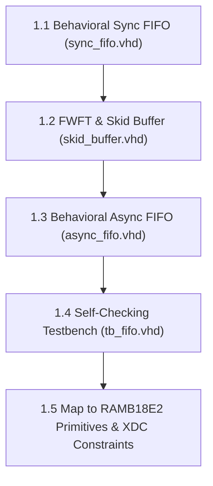
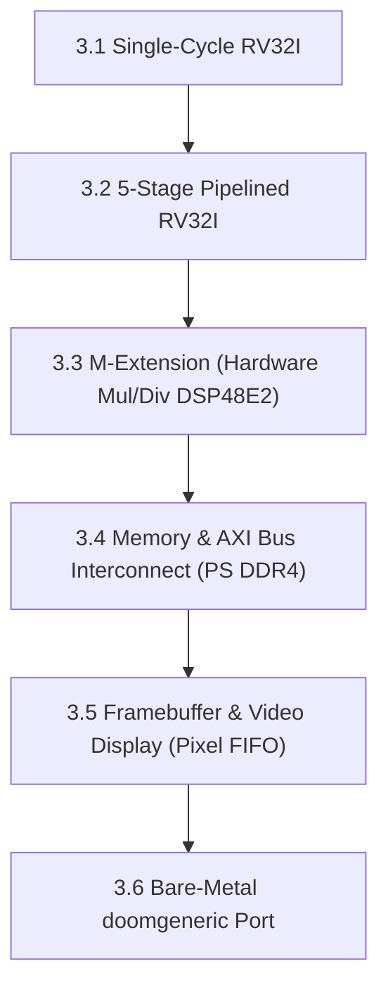
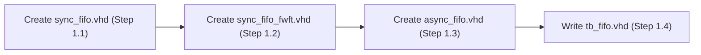

# From FIFOs to DOOM on the KR260: The Complete Digital Design Roadmap

**FIFOs are the gateway drug to professional digital design.** Master FIFOs, and you naturally master:
1. Pipelining, flow control, and backpressure (ready/valid handshakes).
2. Clock Domain Crossing (CDC), metastability, MTBF, and Gray codes.
3. Memory primitives (BRAM, UltraRAM, Distributed RAM) and address decoding.
4. Comprehensive, self-checking verification and race-condition analysis.

This roadmap is organized around a **Behavioral-First Re-learning Strategy**: rather than getting bogged down in low-level Xilinx silicon primitives, you build the concepts cleanly from scratch in portable HDL first, verify them, and then connect them to hardware primitives, UART, and custom CPU.

---

## Phase 1: The "Build From Scratch" FIFO Curriculum (Behavioral First)



### 1.1 Step 1: Pure Behavioral Synchronous FIFO (`sync_fifo.vhd`)
*No CDC distractions. Master pointer wrapping, counter tracking, and memory inference.*

* **Behavioral Dual-Port Memory:** Use inferable VHDL rather than vendor primitives:
  ```vhdl
  type mem_t is array (0 to DEPTH - 1) of std_logic_vector(DATA_WIDTH - 1 downto 0);
  signal mem : mem_t;
  ```
  Vivado will automatically infer Distributed RAM (LUTRAM) for shallow depths or Block RAM for deeper configurations without manual primitive instantiation.
* **Natural Pointer Wrapping:** For depth $2^N$, use unsigned counters of width $N$. Let natural integer overflow handle wrapping from $(2^N - 1) \to 0$.
* **Occupancy Counter:** Maintain an internal `count` register (range $0$ to $\text{DEPTH}$):
  * Write only $\to \text{count} \leftarrow \text{count} + 1$
  * Read only $\to \text{count} \leftarrow \text{count} - 1$
  * Simultaneous Read + Write $\to \text{count} \text{ holds value}$
* **Boundary Flags & Watermarks:**
  * `empty <= '1' when count = 0 else '0';`
  * `full  <= '1' when count = DEPTH else '0';`
  * `almost_empty <= '1' when count <= ALMOST_EMPTY_THRESH else '0';`
  * `almost_full  <= '1' when count >= (DEPTH - ALMOST_FULL_THRESH) else '0';`
* **Corner-Case Analysis:** What happens when `wr_en` and `rd_en` assert simultaneously when the FIFO is completely empty? (Write succeeds, read fails or requires write-through bypass logic).

---

### 1.2 Step 2: Standard Latency vs. First-Word Fall-Through (FWFT) & Skid Buffering
*Understand memory read latency and why stream protocols require zero-latency head-of-queue.*

* **The Problem:** Synchronous BRAM has at least 1 clock cycle of read latency ($N \to N+1$). In stream protocols (like AXI4-Stream), the consumer expects `TDATA` to be valid *at the same moment* `TVALID` is high, not 1 cycle later.
* **Approach A: FWFT State Machine (`sync_fifo_fwft.vhd`):**
  * Prefetch the first word into an output register as soon as the FIFO is non-empty.
  * When consumer reads, immediately trigger a read from the internal RAM to refill the output register.
* **Approach B: The Skid Buffer (Register Slice):**
  * A 2-register ping-pong buffer that decouples `TREADY` and `TVALID` paths.
  * Allows registering both data and control lines, breaking long combinatorial timing paths while providing 100% sustained throughput with zero bubble cycles.

---

### 1.3 Step 3: Pure Behavioral Asynchronous FIFO (`async_fifo.vhd`)
*The leap to multi-clock domains. Why binary counters fail and how Gray codes fix it.*

* **Why an Occupancy Counter is Forbidden across Clock Domains:**
  * In an asynchronous FIFO (`clk_wr` and `clk_rd` are unrelated), you **cannot** share a `count` integer.
  * Passing a multi-bit binary counter across clock domains causes catastrophic transition glitches: e.g., transitioning from $7$ (`0111`) to $8$ (`1000`) flips all 4 bits. If the receiving clock captures during this transition, it might sample `0000`, `1111`, or any random intermediate code.
* **The $(N+1)$-bit Pointer Architecture:**
  * For depth $2^N$, pointers are $(N+1)$ bits wide.
  * Bits $[N-1:0]$ address the RAM.
  * Bit $[N]$ is the **Lap / Wrap Bit** (tracks whether the write pointer has wrapped around the buffer relative to the read pointer).
* **Gray Code Properties:**
  * $G_i = B_i \oplus B_{i+1}$.
  * Only **one bit toggles** per pointer increment.
  * If a 2-FF synchronizer samples during a Gray transition, it will resolve either to the old value or the new value—**never** an invalid intermediate state!
* **The Full and Empty Derivation in Gray Space:**
  * **Empty:** Read Gray pointer matches synchronized Write Gray pointer:
    $$\text{empty} = (rd\_ptr\_gray == wr\_ptr\_gray\_cdc2)$$
  * **Full:** The pointers match in all lower bits, but MSB and 2nd MSB are inverted:
    $$\text{full} = (wr\_ptr(N) \neq rd\_ptr\_cdc(N)) \land (wr\_ptr(N-1) \neq rd\_ptr\_cdc(N-1)) \land (wr\_ptr[N-2:0] == rd\_ptr\_cdc[N-2:0])$$
* **The Pessimistic Flag Rule:**
  * Write domain sees a delayed read pointer $\to$ may think FIFO is fuller than it is, never emptier $\to$ **100% safe against overflow**.
  * Read domain sees a delayed write pointer $\to$ may think FIFO is emptier than it is, never fuller $\to$ **100% safe against underflow**.

---

### 1.4 Step 4: Self-Checking Testbench & Verification (`tb_fifo.vhd`)
*Leave waveform inspection behind; automate verification like a silicon validation engineer.*

* **Testbench Architecture:**
  * **Driver Process:** Pushes randomized data words with bursty, irregular write enable intervals.
  * **Monitor & Checker Process:** Pops data with independent random delays on a different clock frequency.
  * **Golden Model (Scoreboard Queue):** A VHDL-2008 queue or protected type tracking expected words.
* **CDC Corner Stress Scenarios:**
  * Wr clock at 200 MHz, Rd clock at 10 MHz (Fast Write, Slow Read $\to$ stress full condition).
  * Wr clock at 10 MHz, Rd clock at 200 MHz (Slow Write, Fast Read $\to$ stress empty condition).
  * Rapid asynchronous reset asserting while active write/read bursts are underway.

---

### 1.5 Step 5: Connecting Back to Your `RAMB18E2` Primitive Code
Now that the architecture is deeply understood:
1. Re-open [fifo_w32_d2048.vhd](file:///home/kylie/repos/fifo_study/fifo_w32_d2048.vhd) and [ramb18e2_fifo_standard.vhd](file:///home/kylie/repos/fifo_study/ramb18e2_fifo_standard.vhd).
2. Observe how your behavioral dual-port RAM maps to the physical `RAMB18E2` primitive.
3. Understand why vertical cascading saves LUT routing delay.
4. Add the proper Vivado CDC constraints (`XDC`):
   ```tcl
   # Constrain Gray pointer crossing to 1 destination period, disable false path
   set_max_delay -from [get_cells wr_ptr_gray_reg*] -to [get_cells wr_ptr_gray_cdc1*] -datapath_only [get_property PERIOD [get_clocks clk_rd]]
   set_bus_skew  -from [get_cells wr_ptr_gray_reg*] -to [get_cells wr_ptr_gray_cdc1*] 1.500
   ```

---

## Phase 2: The Stepping Stone Project: AXI4-Lite UART with Hardware FIFOs

> [!IMPORTANT]
> The absolute best bridge between your FIFO experiments and a full CPU is an **AXI4-Lite UART Controller with TX and RX FIFOs**.

### Why This Specific Project?
1. **Direct FIFO Reuse:** You immediately embed your freshly built synchronous or asynchronous FIFOs as TX (transmit) and RX (receive) buffers.
2. **Registers & Bus Protocols:** You implement an **AXI4-Lite Slave interface**, learning address decoding, write strobes, and read multiplexing.
3. **Embedded Software Connection:** You write embedded C drivers to configure baud rates, check status flags, read RX characters, and write TX strings.
4. **Future CPU Necessity:** When you build your RISC-V CPU in Phase 3, you will reuse this exact UART core as your serial console to print boot messages and receive player input!

### Architecture of the UART Controller
```
                  AXI4-Lite Bus
                        │
       ┌────────────────┴────────────────┐
       ▼                                 ▼
┌──────────────┐                  ┌──────────────┐
│  Registers   │                  │  Registers   │
│ (BAUD, CTRL) │                  │ (STAT, INTR) │
└──────┬───────┘                  └──────┬───────┘
       │                                 ▲
       ▼                                 │
┌──────────────┐                  ┌──────────────┐
│  TX FIFO     │                  │  RX FIFO     │
│ (axi4s/sync) │                  │ (axi4s/sync) │
└──────┬───────┘                  └──────▲───────┘
       ▼                                 │
┌──────────────┐                  ┌──────────────┐
│  TX FSM      │                  │  RX FSM      │
│  Serializer  │                  │  16x Oversamp│
└──────┬───────┘                  └──────▲───────┘
       │                                 │
       ▼                                 │
   UART_TXD                          UART_RXD
```

### Module Specifications:
1. **Baud Rate Generator:** Fractional or integer accumulator producing 16× oversampling ticks.
2. **RX Receiver:** 16× oversampling state machine with 3-sample majority voting on the middle samples (7, 8, 9) to eliminate serial wire noise, detecting START, 8 DATA bits, and STOP. Writes incoming bytes into the RX FIFO.
3. **TX Transmitter:** Reads bytes from the TX FIFO when not empty, formats START, 8 DATA bits, and STOP bit at the baud rate.
4. **AXI4-Lite Register Map:**
   - `0x00` - `DATA_REG`: Write $\to$ pushes to TX FIFO; Read $\to$ pops from RX FIFO.
   - `0x04` - `STATUS_REG`: TX Full, TX Empty, RX Full, RX Empty, TX Count, RX Count.
   - `0x08` - `CTRL_REG`: Loopback mode enable, FIFO resets, Interrupt enables.
   - `0x0C` - `BAUD_DIV_REG`: Clock divisor for 115200 / 921600 baud.
5. **Hardware Testing on KR260:**
   - Map TXD/RXD pins to the KR260 PMOD connector or Raspberry Pi header.
   - Connect a $5 USB-to-UART FTDI cable to your laptop.
   - Run Python on your PC or minicom to send and receive full-duplex traffic at 921,600 baud!

---

## Phase 3: The Grand Mission: RV32IM CPU from Scratch to DOOM

Now comes the ultimate goal: designing your own microprocessor in HDL, mapping it to the KR260 FPGA, and playing DOOM.



### 3.1 Step 1: The Core (RV32I Base Integer ISA)
* **Start Single-Cycle:**
  - Build the Program Counter (PC), 32-register Register File ($x_0$ tied to 0), ALU, Immediate Generator, and Control Decoder.
  - Run the official RISC-V architectural tests (`riscv-tests`).
* **Transform into a 5-Stage Pipeline:**
  - Standard classic RISC pipeline: **IF (Fetch) $\to$ ID (Decode) $\to$ EX (Execute) $\to$ MEM (Memory) $\to$ WB (Writeback)**.
  - Implement Hazard Detection & Forwarding Unit:
    - Data forwarding from EX/MEM and MEM/WB to EX.
    - Load-Use hazard stall (1 bubble).
    - Branch prediction: simple static branch predictor (predict not taken) with pipeline flush on branch misprediction.

### 3.2 Step 2: Add RV32M Extension (Multiply/Divide)
* DOOM uses fixed-point math (`fixed_t` = 16.16 bits) everywhere for 3D projections, texture mapping, and BSP rendering.
* Pure software emulation of 32-bit multiplication and division will drop DOOM's framerate to < 2 FPS.
* UltraScale+ on the KR260 contains hundreds of **DSP48E2** slices!
  - Instantiate DSP48E2 for 1-cycle or 2-cycle pipelined multiplication (`MUL`, `MULH`, `MULHU`, `MULHSU`).
  - Implement a 32-cycle restoring/non-restoring or radix-4 divider (`DIV`, `DIVU`, `REM`, `REMU`).

### 3.3 Step 3: Memory Subsystem & The DOOM Requirements
DOOM has real memory requirements:
* **Binary + WAD Size:** The shareware `DOOM1.WAD` is ~4.2 MB.
* **Framebuffers:** 320×200 8-bit paletted = 64,000 bytes per frame (usually double buffered $\to$ 128 KB).
* **Heap / Zone Memory:** At least 2 MB to 4 MB for sound, textures, sprites, nodes.
* **Total RAM Needed:** ~8 MB minimum.

#### Interfacing with KR260's 4 GB DDR4:
* Implement an AXI4 Master interface on your RISC-V CPU.
* Connect your CPU's AXI Master to the Zynq MPSoC `S_AXI_HPC0_FPD` or `S_AXI_HP0_FPD` slave port using Vivado IP Integrator.
* Your homemade CPU now directly reads and writes the board's 4 GB DDR4 memory through the Processing System memory controller!

### 3.4 Step 4: Graphics & Video Display Subsystem
* Build a **VGA / DisplayPort Video Controller**:
  - Pixel Clock Generator (e.g. 25.175 MHz for 640×480 @ 60Hz).
  - Timing Generator: `H_SYNC`, `V_SYNC`, `H_BLANK`, `V_BLANK`.
  - Framebuffer DMA Engine: Reads pixels from memory and streams them through—an **Asynchronous Pixel FIFO** crossing from the CPU/DDR clock domain to the pixel clock domain!
  - Palette Lookup Table (CLUT): 256 entries of 18-bit/24-bit RGB values converting DOOM's 8-bit palette indices to full color.
  - Scan Doubler: Doubles 320×200 pixels to 640×400 centered inside 640×480.
  - Video Output: Use the KR260's built-in DisplayPort or a simple resistor-ladder VGA PMOD.

### 3.5 Step 5: Peripheral Checklist for DOOM
1. **Timer (CLINT):** 64-bit microsecond counter. DOOM runs its internal game logic at 35 TICKS per second (`TICRATE = 35`).
2. **UART Controller:** (The one you built in Phase 2!) Used for console outputs, debug printfs, and keyboard input over serial.
3. **Interrupt Controller:** Simple timer and UART interrupt handler.

### 3.6 Step 6: Software & Porting `doomgeneric`
You run DOOM **bare-metal** (no OS required):
1. Toolchain: Standard `riscv32-unknown-elf-gcc`.
2. Minimal C Runtime: `crt0.s` (set up stack pointer `sp`, zero `.bss`, jump to `main`).
3. Porting **`doomgeneric`**:
   You only implement 5 functions in C:
   - `DG_Init()`: Initialize video framebuffer address and UART.
   - `DG_DrawFrame()`: Copy DOOM's 320x200 8-bit frame buffer to your hardware video display memory.
   - `DG_SleepMs(uint32_t ms)`: Wait using your hardware timer.
   - `DG_GetTicksMs()`: Read your 64-bit hardware timer in milliseconds.
   - `DG_GetKey(int *pressed, unsigned char *key)`: Read keystrokes from your UART RX FIFO!

---

## Your Starting Point Today



We start at **Step 1.1: Behavioral Synchronous FIFO (`sync_fifo.vhd`)**.
Let's build it cleanly together.
